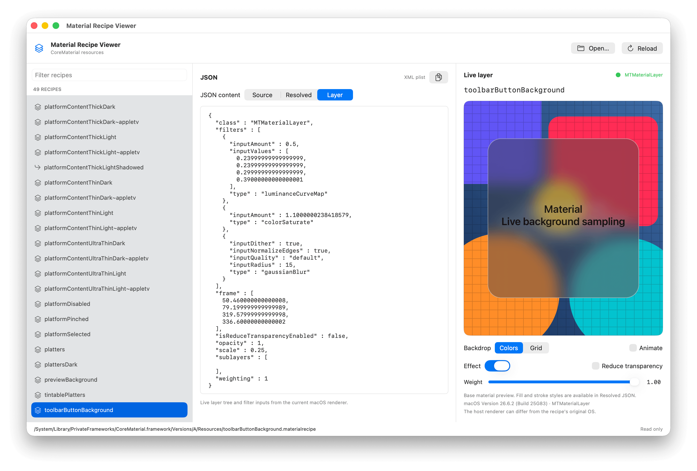

# MaterialViewer

Inspect CoreMaterial recipes as source and resolved JSON, and preview their base
material with the native macOS renderer. The Layer tab shows live filters and
inputs; preview controls adjust weight, transparency, and the background.



## Requirements

macOS 14 or later and Xcode with Swift 6.3 or later. Rendering uses the host's
private CoreMaterial framework, so results can vary between OS versions.

## App

Open [MaterialViewer.xcodeproj](MaterialViewer.xcodeproj) and run the
`MaterialViewer` scheme, or use:

```sh
./run.sh
./run.sh /path/to/example.materialrecipe
```

The app opens `/System/Library/PrivateFrameworks/CoreMaterial.framework/` by
default. Use **Open** to select another recipe or framework folder.
Set your signing team in [common.xcconfig](xcconfigs/common.xcconfig) if needed.

## CLI

```sh
swift run materialviewer --check
swift run materialviewer --check /path/to/example.materialrecipe
```

`--check` prints layer JSON for each recipe and a summary, and exits with a
nonzero status on failures. With no input path, it checks the system framework.
Without arguments, the CLI prints help and exits.

The built app includes an independent CLI at `Contents/Helpers/materialviewer`.
You can copy that binary and run it outside the app.

See [AGENTS.md](AGENTS.md) for project structure, build details, and validation.

## License

[MIT License](LICENSE).
